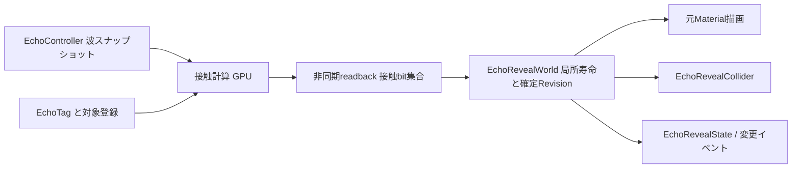

# エコーロケーション拡張仕様設計

作成日：2026-10-22。対象：Unity 6000.6.3f1／現在のOmata_N配下の実装。
状態：設計をもとに実装済み。具体的な設定手順・実装との差分・対応範囲は「Echolocation専用タグと表示領域.md」を参照。以下は設計時の方針を残す。

## 1. 目的と設計上の決定

次の4機能を、既存の塗り・輪郭・発生地点からの遮蔽・機能別の壁越し表示・残存時間・チーム操作と併用できるようにする。

| 要求 | 利用者が行う操作 | 実装上の入口 |
|---|---|---|
| ① 専用タグ | 対象にEchoTagを付け、専用タグアセットを選ぶ。既存Unityタグから一括付与も可能 | EchoTag／EchoTagDefinition／一括付与ウィンドウ |
| ② 全体／接触部分だけの元マテリアル表示 | 表示ルールで「全体」「接触部分」を選ぶ | EchoOriginalRevealMode／共通表示領域 |
| ③ 表示部分だけの衝突 | 対象にEchoRevealColliderを付け、制御対象Colliderと形状データを指定する | 共通表示領域から確定した衝突形状 |
| ④ 有効状態の参照 | EchoRevealState.IsActiveまたは変更イベントを読む | 確定済み表示状態の読み取り専用API |

推奨方針：**分類・対象所有・接触判定・表示寿命・描画・物理・状態通知を分離し、描画と物理には同一の確定済み表示領域を渡す。**

- 専用タグは文字列や固定enumではなくScriptableObject参照とする。タグ追加にコード変更を要求しない。
- 共有の表示設定はController側に残す。タグアセットには分類名と説明だけを置き、色や残存時間を混在させない。
- 物理連動は対象単位の任意追加とし、全オブジェクトのColliderを勝手に変更しない。
- PlayerController／InputSystem_Actionsの変更や独自入力の再導入は行わない。
- 新しい常駐オブジェクト・自動生成シングルトンは作らない。更新管理は明示配置したControllerに対応するEchoRevealWorldが担当する。
- 作業・生成先は原則Omata_N配下。共有シーンやPrefabの変更・移行は別途担当者の合意が必要。

## 2. 現行実装で確認したこと

以下は設計時点の実ファイルを読んだ結果。説明書だけから推測したものではない。

| 既存ファイル（Scripts/Systems/Echolocation/基準） | 現在の責務 | 今回の接続点 |
|---|---|---|
| Runtime/Targets/EchoTarget.cs | 子Rendererの所有範囲。最も近いEchoTargetと手動リストで所有を決定 | 分類はEchoTagへ移し、Renderer所有は維持 |
| Runtime/Targets/EchoTargetRegistry.cs | 候補収集、Unityタグ照合、元Material参照の保管と透明Materialへの一時交換 | 専用タグ解決、登録方式、Material管理を分離 |
| Runtime/Targets/EchoTagResolver.cs | 文字列タグからルールを取得。重複は先頭優先 | SO参照をキーとするEchoRuleResolverへ置換 |
| Runtime/Core/EchoTagColorRule.cs | 塗り・輪郭・元マテリアル・機能別遮蔽・残存時間 | EchoEffectRuleに移行。数値とenumの既存値を保持 |
| Runtime/Core/EchoController.cs、EchoPulseTimeline.cs、EchoFrameData.cs | 波の生成・進行・消去・公開入力API | 波の不変スナップショットを表示領域計算へ渡す |
| Runtime/Rendering/EchoShadowMaps.cs | 発生地点からの深度マップ。Renderer自身のUnityタグで遮断分類 | 専用タグ／明示遮断設定へ移行。毎回の全Renderer検索を登録キャッシュへ置換 |
| URP/EchoObjectEffects.cs | 3軸から接触をGPU描画し最大値縮小、物体ごとの1×1履歴で全体表示 | 接触計算・履歴・元Material描画を分割し、空間的な履歴を追加 |
| Art/Shaders/Echolocation/EchoComposite.shader | 全体表示履歴とシルエットを使い元Material画像を合成 | 部分領域のマスクを追加。物理連動時は確定領域を使用 |
| Editor/EchoTagColorRuleDrawer.cs、EchoControllerEditor.cs | Unityタグの選択と表示設定 | 専用タグアセット選択、モード別の項目表示 |

重要な差分：現状の接触・寿命はGPU内で完結し、CPUへのreadbackを行っていない。1×1履歴には「物体のどこが当たったか」が残らない。そのままでは②の局所残存時間、③の局所Collider、④のCPUから読む正確な状態を作れない。

また、表示分類はEchoTargetの所有者タグを使う一方、遮断分類はRenderer自身のタグを使っている。移行時に親タグだけをコピーすると遮断挙動が変わるため、両者を別々に比較する。

## 3. 用語と『表示されている』の定義

| 用語 | 定義 |
|---|---|
| 対象 | 1つのEchoTargetが所有するRenderer群。全体表示と状態通知の単位 |
| 専用タグ | EchoTagDefinitionへの参照。UnityのGameObject.tagと独立 |
| 接触領域 | 波の球／扇形・消去半径・発生地点遮蔽を満たす表面 |
| 表示領域 | 接触領域と接触後の残存履歴を合成した領域 |
| 確定領域 | CPU側で受領し、描画・Collider・公開状態へ同じRevisionで反映した領域 |
| IsActive | 元マテリアルの表示領域が対象に1つ以上存在する状態。画面外・カメラ遮蔽だけではfalseにしない |
| IsVisibleToTargetCamera | 指定Game Cameraのエコー合成マスクに表示画素がある状態。IsActiveとは別。取得は任意 |
| GameObjectのactiveSelf | Unityのオブジェクト有効状態。本仕様のアクティブ状態とは別物 |

**③④の推奨解釈は『エコーによって物体が現れている状態』である。** カメラから見えなくなっただけで床や壁が消える仕様にはしない。カメラによる壁越し表示設定は見た目だけに作用し、接触履歴と衝突を変えない。

ユーザーが『実際に画面に映った部分だけが固体』を意図する場合は別仕様となる。複数カメラのどれを基準にするか、視点移動で床が消える挙動を許容するかの確認が必要。本案ではこれを暗黙に実装しない。

Renderer.isVisibleは使用しない。影やScene Viewのための描画でもtrueになり得て、今回の元マテリアル表示マスクを表していない。

## 4. ① 専用タグと所有規則

### 4.1 データ

- EchoTagDefinition : ScriptableObject。表示名、説明。アセット参照を識別子とし、表示名の変更では対応が切れない。
- アセット例：Settings/EchoTags/SO_EchoTag_Enemy.asset、SO_EchoTag_Item.asset、SO_EchoTag_Structure.asset。
- EchoTag : MonoBehaviour。`[SerializeField] private EchoTagDefinition _definition`。読み取り専用Definitionと、変更通知を伴うSetDefinitionを公開。
- EchoTagはDisallowMultipleComponent。RequireComponentでEchoTargetを要求し、同一GameObject上の1つの分類を所有Renderer群へ適用。
- 初期版は1対象1タグ。複数タグの優先順位は導入しない。複数機能の併用は1つの表示ルールの中で行う。
- EchoEffectRule：Definition参照と既存表示設定。未設定・重複はInspectorでエラー表示。移行中の重複は現在と同じ先頭有効行を採用し、診断を出す。

### 4.2 解決順

1. Rendererの最も近いEchoTargetを収集時にキャッシュする。
2. そのEchoTargetと同じGameObjectの有効なEchoTagを分類として使用する。
3. 手動Renderer一覧・子EchoTargetとの所有境界は現在のOwns規則を維持する。
4. 子EchoTargetにタグがなければ『未分類』。親タグへ勝手に戻らない。子境界が意図せず消えるのを防ぐ。
5. タグがない対象には強調表示しない。Layerは対象候補の絞り込みとして引き続き使う。
6. 初期版は分類変更時にその対象の履歴をリセットする。別カテゴリの残存表示やColliderが引き継がれないようにする。

遮断物は『強調対象であること』を必須にしない。専用タグの遮断ルールと、タグなし遮断物の既定値を使う。個別の遮断例外が必要な場合はEchoOccluderのOverride（既定／遮断／透過）を優先する。元Materialを隠している物体も、遮断設定が有効なら論理的な元形状で波を遮る。描画状態→遮断→描画状態という循環を作らない。

### 4.3 一括付与ツール

メニュー案：Tools → エコーロケーション → 専用タグを一括付与。

| UI | 仕様 |
|---|---|
| 対象範囲 | 初期値は現在のシーン。選択オブジェクト配下、明示選択したロード済みシーンにも対応 |
| 検索条件 | Unityタグのドロップダウン。既存のタグのみ。タグ自体は変更しない |
| 付与する分類 | EchoTagDefinitionのアセット欄。未指定では実行不可 |
| 非アクティブも含める | 初期値ON。Sceneの非アクティブ階層も検索 |
| 既存EchoTag | 初期値はスキップ。置換は明示選択した場合のみ |
| プレビュー | 階層パス、対象Renderer数、追加／置換／スキップ／競合、変更予定シーンを一覧表示 |
| 適用 | 追加・設定変更を1つのUndoグループとして実行。再実行しても重複追加しない |

付与先はUnityタグが一致したGameObject自身。Rendererがなく子にある場合、追加されるEchoTargetの所有範囲をプレビューする。親子双方が一致するときも隠れて自動統合しない。ネストによる所有変更を警告する。

PrefabインスタンスはシーンOverrideとして変更し、PrefabアセットにはApplyしない。Prefab Mode、未ロードシーン、Project内のPrefab原本は標準対象外。Omata_N以外のシーンは初期状態で対象外とし、明示的な対象選択と担当者の合意を必要とする。Undo.AddComponent、Undo.RecordObject、PrefabUtility.RecordPrefabInstancePropertyModifications、MarkSceneDirtyを使用し、自動保存しない。途中で失敗した場合はUndoグループを戻し、件数と理由を報告する。

## 5. ② 元マテリアル表示のモード

EchoOriginalRevealModeを別ファイルに定義する。WholeObject = 0、ContactRegion = 1。既存値の初期動作はWholeObjectとする。

| 設定 | 全体表示 | 接触部分表示 |
|---|---|---|
| 最初の接触 | 対象の一部に届けば所有Renderer群全体を表示 | 届いた局所領域のみ表示 |
| 再接触 | 対象全体の残存期限を更新 | 当たった局所領域の期限だけを更新 |
| 残存時間0 | 接触中のみ | 各領域が接触中のみ |
| 壁の裏にある未接触部分 | 一部接触すれば全体表示の対象となる | 波の遮蔽で未接触なら現れない |
| カメラ遮蔽 | 既存OriginalOcclusionを使用 | 同左。論理領域は変化しない |
| 塗り・輪郭 | 従来どおり併用 | 同左。輪郭は対象全体の外周であり、部分境界を新たな輪郭にはしない |

波が複数ある場合、領域ごとの接触はORとし、最後の有効接触時刻を保存する。`isRevealed = isContacting || (holdSeconds > 0 && now < lastContactTime + holdSeconds)`。最初の未接触は時刻0ではなく未接触フラグで表現する。境界時刻では非表示にする。

『接触』は現在のEchoFrameDataと同じ球／扇形／消去領域の評価に従う。波の先端の薄い帯だけへ仕様変更しない。スキャン停止後も既存の波消去と元Material残存時間を尊重する。Controller／Worldを無効化・破棄した場合は即時解除し、履歴を再利用しない。

### 5.1 空間履歴と部分表示

初期版の共通表現として、Editorで表面を小領域（以下パッチ）へ分割したEchoSurfaceDataを採用する。画面UVではなく、元Mesh・submesh・局所三角形と対応するPatchIdを保存する。別の面が同じUVを使うモデルでも履歴が混ざらない。

- 表面三角形を最大パッチ辺長以下へ分割し、元の位置・法線・接線・UV・submeshを補間して保持する。
- 接触は各パッチの実形状を発生地点遮蔽付きでラスタライズし、PatchIdごとにOR集約する。中心点やboundsだけで接触確定しない。
- 薄い物体の見逃し、遮蔽境界でのパッチ内漏れは有限解像度の誤差として測定する。接触解像度とパッチサイズの両方をInspectorで指定する。
- パッチ全部を表示するので、波境界はパッチ単位で近似される。『任意のモデルでピクセル単位の完全一致』とは表現しない。
- 滑らかなピクセルマスクは将来のVisualOnlyモードとして追加できるが、同じモードのままColliderだけ粗くして一致を装わない。
- 全体表示では既存の1対象単位の接触表現も利用できる。部分表示・部分衝突がない対象に細分割を要求しない。

**重要：このパッチ精度を許容するかは実装前の確認事項。** 完全連続な境界が必要なら、局所履歴・三角形切断・衝突Mesh再生成まで必要な別工程になる。初期実装の見積もりに含めて『簡単に可能』と約束しない。

### 5.2 元Materialを維持する描画

元の共有Materialアセットは変更しない。現在の通常非表示・元参照復元の仕組みはEchoOriginalMaterialStoreへ切り出す。

部分表示は、元Meshから作ったパッチの描画用Meshと元Materialを持つプロキシRendererを用意し、有効なパッチだけを元Material描画パスへ渡す。通常カメラ描画には出さず、既存のEchoOriginal専用パスと同様にUnityの照明情報がある経路で描く。不可視パッチが深度を書いて可視パッチを遮らないことを必須とする。最終カラーだけを切り抜き、非表示面の深度を残す実装は不可。

元Rendererは塗り・全体輪郭・波の遮断形状の入力として保持する。プロキシは登録対象・遮断対象から明示除外し、二重検出を防ぐ。プロキシは対象配下に必要数だけ生成し、プールして再利用する。常駐管理オブジェクトは生成しない。

初期版の部分表示は静的MeshRendererと、検証済みのURP Lit／Unlitの不透明Materialを対象にする。透明・AlphaClip・屈折・頂点変形・SkinnedMesh・LOD切替は、全体表示の既存対応を維持しつつ、部分表示／部分衝突は未対応と明記する。透明テクスチャの穴まで衝突を一致させるには追加の形状生成が必要。

プロキシはlightmapのindex／scaleOffset、probe設定、MaterialPropertyBlockなどのコピー要否を検証する。描画負荷、照明の継承、境界の継ぎ目が基準を満たさなければ、この方式の採用を次工程へ進めない。

## 6. ③ 表示領域と衝突の連動

EchoRevealColliderを任意で付与する。EchoCollisionModeはUnchanged = 0、WholeObject = 1、RevealedRegion = 2。

| モード | 動作 |
|---|---|
| Unchanged | Colliderを管理しない。既存オブジェクトの既定値 |
| WholeObject | 全体表示の確定状態に合わせ、明示リストのColliderをON/OFF |
| RevealedRegion | 確定したパッチのColliderだけをON。他の部分は通過可能 |

ContactRegion表示にWholeObject衝突を指定すると、見えない部分へ衝突するためInspectorで設定エラーとする。WholeObject表示＋RevealedRegion衝突では表示領域が全体なので全パッチが有効になる。Collider連動時はOriginalEnabled、HideOriginalOutsideEcho、表示Opacity > 0が必要。条件不成立では管理下の衝突を有効にしない。

### 6.1 形状と対象範囲

- 全体衝突は既存Colliderを明示リストで指定し、enabledの初期値を記録する。初めから無効だったものは勝手に有効化しない。
- 部分衝突はベイク済みパッチMeshを使う固定MeshCollider群を事前生成し、enabledだけを切り替える。実行中の毎フレームMesh生成・cookingは行わない。
- 元の全体Colliderを残したままパッチColliderを追加しない。置き換えるColliderの明示リストを要求し、意図的に残すTrigger等は対象外にする。
- 非convexパッチColliderの対象は初期版では静止物。相手はプレイヤーのCapsule／Box等のconvex系Colliderを想定する。動く足場、非kinematic Rigidbodyの部分固体化、SkinnedMeshの部分衝突は別工程。
- MeshColliderは片面であるため、面の向きが正しいことをベイク時に確認する。裏面衝突が必要なら描画も両面にする専用仕様を選ぶ。勝手に凸包化して穴を塞がない。
- 衝突する相手のLayerはUnity既存のレイヤー設定を使用する。管理対象のレイヤー変更は明示設定した対象だけに限定し、共有Physics設定を自動変更しない。
- Collider自体の存在を切り替えるので、物理接触だけでなく通常のRaycastにも反映される。OnCollisionEnterで後から無視する方式は使わない。

### 6.2 固体化時のめり込み

見えていなかった壁を通過中にColliderを有効化すると押し出しが起こる。既定は『重なっているパッチは表示と衝突を一緒に保留』とする。

次の物理ステップで候補をNonAllocの広域照会→対応形状の狭域判定で検査する。重なり中はそのパッチを確定集合に入れず、離れた後に有効化する。保留でタイマーを延長せず、期限が切れたら表示しない。保留中はPendingPatchCountで診断できる。接触許容距離はSerializeFieldで設定し、乗っているだけの状態を深いめり込み扱いしない。

『先に表示だけして衝突を遅らせる』は③の一致条件を破るため標準では行わない。消える床の上のプレイヤーは落下する仕様とし、自動で保持時間を伸ばさない。必要ならゲーム側から明示的な保持機能を別途追加する。

### 6.3 寿命と解除

無効化・破棄・シーンアンロード・分類変更で、生成Colliderを停止／回収し、管理していた既存ColliderとMaterialを取得時の状態へ戻す。これはエコー管理から通常オブジェクトへ戻す動作であり、状態APIはfalseとなる。

外部スクリプトが同じCollider.enabledを直接操作することは非対応。外部から制御したい場合はSetCollisionSuppressed(bool)を使い、抑止解除で初期状態を壊さない。抑止中の表示は維持されるため、IsActiveとHasActiveCollisionは別プロパティとして公開する。

## 7. 共通更新パイプライン



### 7.1 同期契約

1. 各計算要求にWorldId、TargetId、Generation、Sequence、SampleTime、TransformVersionを付ける。
2. EchoFrameDataと遮蔽マップを同一要求のスナップショットとして固定し、後から更新されたController値を混ぜない。
3. 接触計算は画面の視錐台やScene Viewに依存させない。EchoRevealWorldに登録した対象を評価する。全Game Cameraが無効でも更新できる専用評価経路を用意し、カメラのRenderGraph内でしか進まない現在の構造から分離する。
4. GPU結果はAsyncGPUReadbackで取得する。コールバックでは結果を待機バッファへ入れるだけとし、Unityオブジェクト・Collider・購読者イベントを触らない。
5. 描画・物理・IsActiveは確定Revisionだけを参照する。先に新しいGPU画像だけを見せない。衝突なしの場合も同じ状態契約を使い、モード切替で意味が変わらないようにする。
6. FixedUpdateの冒頭で、寿命更新→めり込み検査→全対象のCollider反映→描画用確定集合の切替→状態値更新→イベント通知の順で実行する。Unity標準の自動Physicsシミュレーションを前提にする。手動Physics.Simulateは初期版対象外。
7. タイマーはSampleTime基準で計算する。受領時刻からn秒を足して遅延分だけ長く表示しない。hold=0でも最新接触スナップショットを次の有効結果まで保持し、未着の結果を未接触とは扱わない。
8. Scaled時間はポーズで停止する。Unscaled時間・衝突なしではUpdateで確定可能。Unscaledと衝突連動を併用してtimeScale=0のときは、描画／衝突の確定更新を停止し、復帰時に実時間に基づいて期限を評価する。この組合せはInspectorに説明を表示する。
9. 破棄済みGeneration、古いSequence、形状変更前の結果は破棄。解除後に遅れて来た結果で再表示・再衝突させない。
10. AsyncGPUReadback非対応・失敗時は前の確定状態を短い猶予中のみ維持する。猶予超過で描画と管理下衝突を同時に非表示／無効化し、IsOperational=false、診断理由を通知する。標準猶予の案は0.25秒（実時間）。値は実機試験で確定する。

AsyncGPUReadbackには数フレームの遅延がある。波が触れた瞬間から確定表示までの遅延はゼロにできるとは約束しない。見た目と衝突の一致を優先し、遅延許容が厳しい場合は同じIEchoContactBackend契約のCPU実装を別途検討する。同期ReadPixels／WaitAllRequestsで毎フレーム待つ代替は採用しない。

### 7.2 GPU接触バックエンドの具体的な処理

初期の部分表示対象は静的Meshなので、ベイク時にパッチごとに重ならない評価用UVタイルも生成する。これは元Material用UVとは別のデータであり、元テクスチャの配置を変更しない。

1. EchoRevealWorldのLateUpdateで、既存Controllerの波更新完了後に要求を作る。更新順は実行順属性と明示呼び出しで固定し、暗黙のMonoBehaviour順序に頼らない。
2. URP側バックエンドが管理するオフスクリーン評価用CommandBufferで、同じ要求の源点遮蔽マップを準備する。通常Game Cameraの有効／無効やRenderGraphのカリングに依存させない。
3. パッチMeshを評価用UVタイルへラスタライズし、補間されたワールド座標で既存の波・扇形・消去・源点遮蔽判定を行う。各面が独立したタイルを持つので、裏面や別面との重なりで接触が消えない。
4. 各タイル内の接触をmax縮小し、PatchId順の接触値バッファへまとめる。全体表示対象は対象ごとのORも計算する。画面全体の画像をCPUへ転送せず、対象／パッチごとの小さい結果だけを読む。
5. AsyncGPUReadbackを要求し、7.1の確定処理へ渡す。局所寿命はCPU側EchoRevealHistoryが唯一管理し、同じ残存時間をGPU側で独立計算し直さない。

タイルの最低解像度、薄い三角形のサンプル不足、斜めの遮蔽境界は段階0の検証対象。ラスタライズによる有限精度をなくせるとはしない。ピクセル幅未満の領域を厳密に扱う要件がある場合は、CPUによる三角形交差計算等を含め方式を再検討する。計算シェーダーが必要な実装を選ぶ場合は、対象GPUの対応確認と明示エラーを追加する。

ベイク対象外のSkinnedMesh等で全体表示を維持する場合は、既存の3軸接触計算を同じオフスクリーン要求へ移し、1対象の接触結果として返す。部分衝突のない対象までパッチベイクを必須にしない。

### 7.3 リソースと登録

- EchoRevealWorldはControllerに明示参照を持つ。対象もWorldを明示参照し、毎フレームFindで所属を探さない。一括ツールでまとめて設定できるようにする。
- 初期版は1対象に対し状態・衝突を決めるWorldは1つ。複数Worldからの二重所有は設定エラー。他カメラは同じ確定状態を描画可能。
- OnEnable／OnDisable、明示RefreshRenderers、シーン登録でキャッシュを更新する。描画・遮断に使うGetComponent／Findは登録時だけにする。
- Worldが無効な間に対象が有効化されても登録要求を保持し、World再有効化時に再登録する。自動グローバル常駐は使わない。
- 対象・パッチ・世代番号の再利用を管理し、readback中バッファは完了まで解放／上書きしない。リクエスト上限を超えたら新規計算を抑制し、未完了要求を無限に積まない。
- プール・辞書・NativeArrayは事前容量を確保する。毎フレームのnew／文字列結合を避け、エラーは状態変化時に1回だけ表示する。

## 8. ④ 外部参照API

EchoRevealStateはEchoTargetと同じGameObjectに付ける。外部へ可変コレクションやpublicフィールドを渡さず、読み取り専用値とイベントを公開する。

```csharp
// 提案API。実装済みコードではない。
public bool IsActive { get; }              // 確定した元Material表示領域が存在
public bool HasActiveCollision { get; }    // 管理下で有効なColliderが存在
public bool IsOperational { get; }         // 参照・ベイク・GPU計算が正常
public float RevealedFraction { get; }     // 面積重み付き表示率（0～1）
public uint Revision { get; }              // 対象の確定領域が変化した番号
public int PendingPatchCount { get; }      // めり込み等で保留した領域数
public event Action<EchoRevealSnapshot> StateChanged;
public bool TryGetVisibility(Camera camera, out EchoViewVisibility visibility);
```

EchoRevealSnapshotは上記値、ChangeReason、評価時刻を含むreadonly struct。EchoViewVisibilityはIsVisible、HasValidSample、SampleFrameを持つ。未測定と非表示を区別する。カメラ別表示は必要な対象のみ最終合成マスクの画素数を集約し、非同期で取得する。黒いMaterialや背景と同色のMaterialは色差で判定しない。対象Cameraの指定、除外するUI／Scene View、Opacity閾値を固定する。

IsActiveは塗り／輪郭だけではtrueにしない。OriginalEnabled=false、Opacity=0、対象Rendererがすべて無効、未分類、World無効ではfalse。部分表示は1パッチでも表示されていればtrue。通常表示のMaterialが残るHideOriginalOutsideEcho=falseでは『エコーによる元Material追加表示』だけを数え、通常描画の可視状態とは区別する。

StateChangedは確定領域／有効状態／衝突状態／正常性が変わった場合だけ発火する。毎フレーム同値通知しない。通知前に全対象の状態を確定する。購読者がタグ変更・破棄・再登録を要求した場合は次の更新へ予約し、列挙中の辞書を変更しない。

利用例：参照はInspectorで設定するかAwakeで1度取得し、OnEnableで購読＋現在値を読む。OnDisableで解除する。イベント受信メソッドはHandleRevealStateChanged、発火用メソッドはOnStateChangedとする。GameObject.SetActive(IsActive)を対象自身に呼ぶと、再接触を受け取れなくなるため使わない。

## 9. Inspector構成と初期値

| 場所 | 項目 | 初期値・挙動 |
|---|---|---|
| EchoTag | 専用タグ／World | 未指定は警告。自動推測しない |
| Controller → 専用タグと表示 | 分類、塗り、輪郭、元Material | 既存の表示数値を移行 |
| 元Material | 表示モード、接触後残存、Opacity、壁越し表示 | WholeObject、現在値継承 |
| EchoRevealState | 状態・表示率・Revision・遅延・エラー | 読み取り専用の実行時診断 |
| EchoRevealCollider | 連動モード、管理Collider、ベイクデータ、めり込み許容 | Unchanged。部分衝突は明示選択 |
| ベイク画面 | 最大パッチ辺長、最大パッチ数、対象Mesh一覧 | 案：0.1m、1対象512パッチ。性能試験後に確定 |
| EchoRevealWorld | Controller、readback要求数上限、遅延猶予 | 案：同時要求3、猶予0.25秒 |

ベイク時の値はワールド寸法へ換算し、非一様Scaleを含めて誤差上限を表示する。実行時のMesh／Scale変更でベイクが無効になる場合は診断を出して対象を停止する。SourceMesh参照、依存ハッシュ、Transform条件をデータに保存し、古いベイクを黙って使用しない。

## 10. ファイル分割と依存方向

以下は必要な責務の一覧。表の型は各々同名の.csに置き、enum／struct／interfaceも1ファイル1型とする。実装のない拡張用クラスを先行量産しない。

基準：Assets/_Sandbox/Omata_N/Scripts/Systems/Echolocation/。

| 配置 | ファイル／型 | 責務 |
|---|---|---|
| Runtime/Tags | EchoTag、EchoTagDefinition、EchoRuleResolver | 対象分類、分類アセット、ルール検索 |
| Runtime/Core | EchoEffectRule、EchoOriginalRevealMode | 表示設定、全体／部分enum |
| Runtime/Targets | 既存EchoTarget、EchoTargetRegistry、EchoRenderItem、EchoTargetEntry | 所有・登録・描画提出を専用タグへ対応 |
| Runtime/Rendering | EchoOriginalMaterialStore | 通常非表示と元Material参照の取得／復元 |
| Runtime/Rendering | EchoOccluder、EchoBlockerRegistry、EchoBlockingOverride | 遮断の明示指定、遮断物キャッシュ、enum |
| Runtime/Reveal | EchoRevealWorld | 明示配置の更新・登録・確定処理 |
| Runtime/Reveal | EchoRevealState、EchoRevealSnapshot、EchoRevealChangeReason | MonoBehaviourの公開状態、不変通知値、理由enum |
| Runtime/Reveal | EchoContactRequest、EchoContactResult、IEchoContactBackend | 計算要求・結果・描画API非依存の契約 |
| Runtime/Reveal | EchoRevealHistory、EchoRegionSnapshot | パッチ別寿命、確定領域の読み取り専用スナップショット |
| Runtime/Reveal | EchoSurfaceData、EchoSurfacePatch | ベイクアセット、パッチ記述データ |
| Runtime/Reveal | EchoViewVisibility | カメラ別の観測値 |
| Runtime/Physics | EchoRevealCollider、EchoCollisionMode | Collider所有・切替・復元、モードenum |
| Runtime/Physics | EchoCollisionActivationGuard | 固体化前の重なり検査 |
| URP | EchoGpuContactBackend、EchoContactReadback | 接触GPU要求、非同期結果の搬送 |
| URP | EchoOriginalRenderPass、EchoOutlineRenderPass | 既存EchoObjectEffectsの描画責務を分離 |
| URP | EchoSurfaceRenderProxy | ベイク済みパッチとUnity照明経路の接続 |
| Editor/Tags | EchoTagEditor、EchoTagDefinitionEditor、EchoTagBatchWindow | 単体編集・SO編集・一括付与UI |
| Editor/Tags | EchoTagMigrationService、EchoTagMigrationReport | Unityタグからの移行計画・適用、結果データ |
| Editor/Reveal | EchoSurfaceBaker、EchoSurfaceBakeWindow | 分割Mesh生成、見積もり・実行UI |
| Editor/Reveal | EchoRevealStateEditor、EchoRevealColliderEditor | 実行時診断、依存設定の検証 |
| Editor | EchoEffectRuleDrawer、既存EchoControllerEditor／EchoSetupValidator | 新ルールUI、統合Inspector／診断 |

ShaderはArt/Shaders/Echolocation配下にEchoContactPatch.shader、共通のEchoRevealRegion.hlslを追加する。既存EchoHighlight.shader／EchoComposite.shaderは共通判定と全体描画を維持する。ベイクデータはSettings/EchoSurfaces/SO_EchoSurface_*.asset、生成Meshはそのサブアセットとし、元Meshを上書きしない。

asmdef：Echo.RuntimeにUnityEngineとCPU契約を置き、UnityEditor／URP／InputSystemを参照させない。Echo.URP→Echo.Runtime、Echo.Editor→Echo.Runtime／Echo.URP、Tests→必要な対象アセンブリという一方向にする。RuntimeからURPの具体型を直接生成しない。RendererFeatureから明示Worldへバックエンドを接続する。切断時はIsOperational=falseにする。

既存のEchoObjectEffects内にさらに全機能を詰め込まない。単純な局所処理はメソッドとして分け、独立してテスト・交換する責務だけを別型にする。定数はPascalCase、boolはis／has／can、privateは_camelCase、InspectorはSerializeField private、ハンドラはHandleを徹底する。Unity固有のOnEnable等は名前を変更しない。

## 11. 既存データの移行

1. 新タグ／新ルールを追加する段階では、旧EchoTagColorRuleと文字列設定を読める状態にする。新旧同時描画は禁止。
2. 専用移行ツールがControllerの表示・遮断ルール、対象Rendererの実効Unityタグ、所有境界を収集する。
3. 各タグのSOをOmata_N内に生成し、対応表を作る。表示名だけで既存SOを自動再利用せず、既存参照をユーザーが指定できるようにする。
4. 表示ルールの値をすべてコピーする。WholeObject、Collision=Unchangedを既定とし、移行だけで新たな衝突を発生させない。
5. 一括付与プレビューで『移行前の実効ルール』と『移行後の実効ルール』をRenderer単位に比較する。親分類とRenderer自身の遮断タグが異なる場合はEchoOccluder Overrideまたは子の所有境界で保持し、未解決をエラーにする。
6. ControllerとTargetに明示World参照を設定する。既存のチームPlayerControllerから呼ぶAPI名と引数は変えない。
7. 対象数・Material・表示設定・遮断設定の一致、Undo、Prefab Overrideを検証してから旧形式を無効化する。
8. 全対象の移行完了後に旧Resolver／旧Drawer／文字列依存を削除する。ランタイムのUnityタグフォールバックを永久には残さない。

FormerlySerializedAsだけではstring→SO参照への変換はできないため、明示移行が必要。型名・ファイル名の変更時は既存.meta GUIDを維持し、必要なシリアライズ移行属性を検討する。新規ファイルは固有.metaを作る。アセット複製はUnity AssetDatabase経由とし、既存.metaをコピーしてGUID重複を起こさない。

## 12. 実装順と完了条件

| 段階 | 実装 | 完了条件 |
|---|---|---|
| 0 技術検証 | 静的な床・壁でパッチ描画／衝突／readbackを試す | 境界精度、照明、遅延、CPU/GPU/Physics負荷を測定。方式採否を決定 |
| 1 分類と移行 | 専用タグ、登録、SO、一括付与、遮断移行 | Unityタグ依存を外して既存の塗り・輪郭・全体表示が維持される |
| 2 全体状態 | 明示World、GPU結果受領、全体寿命、IsActive／イベント | 画面外でも状態更新、破棄後の遅延結果を排除、既存操作維持 |
| 3 部分表示 | ベイク・局所履歴・元Materialプロキシ | 未接触領域が表示されず、再接触が他領域の期限を延長しない |
| 4 衝突 | 全体Collider制御、部分Collider、めり込み保留 | 描画とColliderが同じ確定Revision、非表示領域を通過可能 |
| 5 統合と運用 | 診断、ドキュメント、移行結果、回帰試験 | チームプレイヤーで操作・ポーズ・リロードを確認 |

③を後付けしてGPU／CPUの二重判定にする順番は避ける。段階0で②③④共通の領域表現を確定させる。

## 13. 試験仕様

| 分類 | 必須ケース |
|---|---|
| 専用タグ | タグなし、Definitionなし、重複ルール、親子所有、手動Renderer、タグ改名、動的生成、無効化／再有効化 |
| 一括付与 | 選択範囲、非アクティブ、親子同時一致、既存タグのスキップ／置換、Prefab Override、Undo/Redo、繰り返し適用、共有シーン除外、途中失敗 |
| 移行 | Rendererごとの表示／遮断分類一致、全数値保持、元Material参照保持、未解決衝突の報告、旧形式の無効化 |
| 全体表示 | 接触中、n秒残存、0秒、再接触、スキャンOFF消去、Controller無効化、複数波、画面外 |
| 部分表示 | 大きい床の一部接触、壁裏、薄い壁、別面の重複UV、パッチ継ぎ目、局所再接触、元Materialの照明、Opacity=0 |
| 遮蔽 | 源点の遮蔽で接触を止める。カメラ遮蔽だけでは履歴／衝突を消さない。塗り・輪郭・元表示の独立設定 |
| 衝突 | 表示領域だけで停止、非表示領域を通過、Raycast一致、初めから無効のCollider、Trigger保持、めり込み保留、足場の消滅、レイヤー制御 |
| 状態 | 初期false、最初の接触で1回通知、同値通知なし、部分の面積率、画面外維持、IsActiveとGameObject.activeSelfの独立 |
| 非同期 | 結果の遅延／順序逆転／失敗、対象破棄／世代再利用、World無効化、バッファ解放、ポーズ復帰、GPU非対応 |
| ライフサイクル | Scene/Domain ReloadそれぞれON/OFFの4組合せ、加算ロード、登録解除後の復元、常駐オブジェクトが増えない |
| 回帰 | 現行の塗り・全体輪郭・元Material全体表示・除外ルート・チーム入力・ポーズ／復帰 |

性能の暫定試験条件：対象100個、同時接触10個、部分衝突用パッチ合計2,000、1920×1080で計測。これらは保証値ではない。起動／ベイク後の定常時GC allocationを0 B/frameの目標とし、CPU、GPU、Physics、readback遅延、最大フレーム時間、メモリを記録する。60FPSの達成可否は使用GPUと展示PCで判定する。満たさなければパッチサイズ・対象上限をUIへ反映し、無制限に生成しない。

## 14. 実装前に確認する点（推奨案付き）

1. 『表示』は世界内の出現状態か、画面の画素か：**世界内の出現状態を推奨**。カメラ別状態は別API。
2. 部分表示／衝突の境界にパッチ単位の近似を許容するか：**最大辺長0.1mを出発点に、床の実機試作で決定**。ピクセル完全一致は本案の保証外。
3. 最初の対象は何か：**静止した不透明な床・壁を推奨**。動的Rigidbody・SkinnedMesh・透明テクスチャの穴までの衝突は次段階。
4. 接触から表示まで数フレーム遅れることを許容するか：**描画と物理の同時確定を優先**し、実機で遅延を評価。
5. 固体化時に人が重なっていたらどうするか：**その領域の表示・衝突を一緒に保留**。強制押し出しはしない。

これらは要求を勝手に削るための条件ではなく、③を安全かつ測定可能な仕様にするための決定事項。未決定のまま『任意形状で完全一致する』として実装を開始しない。①のタグ設計・移行ツールはこれらと独立して着手可能。

## 15. 参照

- リポジトリ：`docs/coding-rules.md`、`docs/CONTRIBUTING.md`。本仕様の規約はローカルの現行ファイルを確認。
- 既存説明：同フォルダーの `導入手順.md`、`Echolocation表示設定.md`。
- Unity公式：[AsyncGPUReadback](https://docs.unity3d.com/6000.0/Documentation/ScriptReference/Rendering.AsyncGPUReadback.html) — 非同期取得と数フレームの遅延。
- Unity公式：[Mesh colliders](https://docs.unity3d.com/6000.0/Documentation/Manual/mesh-colliders-introduction.html) — 非convexの制約、形状更新の負荷、片面の衝突。
- Unity公式：[Renderer.isVisible](https://docs.unity3d.com/6000.0/Documentation/ScriptReference/Renderer-isVisible.html) — Scene Viewや影による可視判定の注意。

Unity公式資料は6000.0系のAPI／概念資料。実装時は使用中の6000.6.3f1とURPパッケージで実挙動を確認する。本設計のGPU評価経路・プロキシ描画・衝突精度はまだ実装検証済みではない。
